# Valle de los Cerezos

Mundo 3D de un valle japonés de cerezos en flor, renderizado en tiempo real en el navegador con Three.js. El paisaje se genera por código (terreno, río, edificios, vegetación, nubes y luz) y se viste con texturas reales CC0 de Poly Haven: hierba, roca, caminos, madera japonesa, tejas, muros de piedra, corteza, ramas de abeto, hojas y helechos (ver [assets/CREDITOS.md](assets/CREDITOS.md)).

Es la base de un juego souls-like: un caballero recorre el valle a pie, habla con sus habitantes, descansa en hogueras y combate contra rōnin huecos camino de las arenas de los jefes.


| | |
|---|---|
| 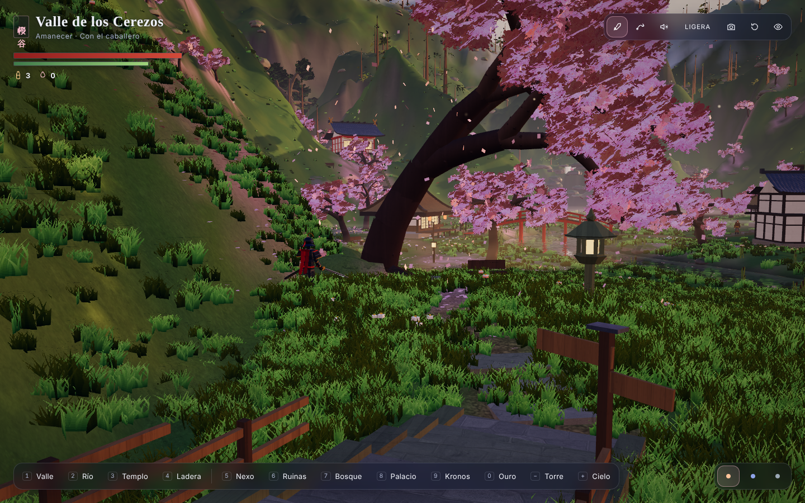 | 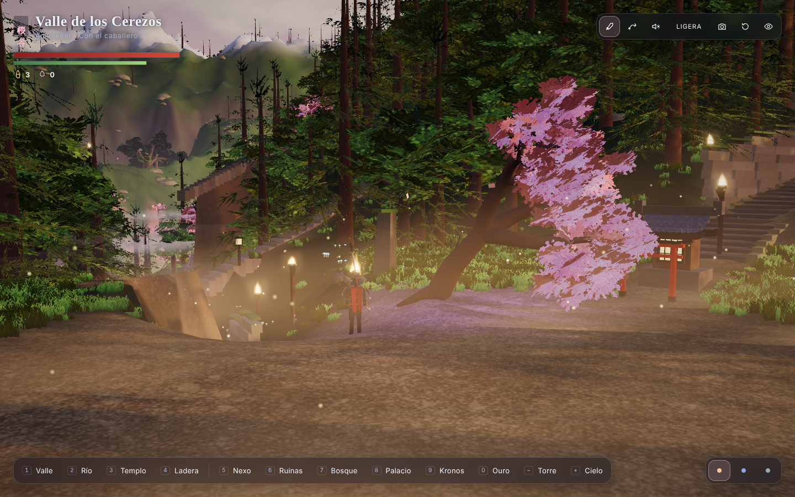 |
| 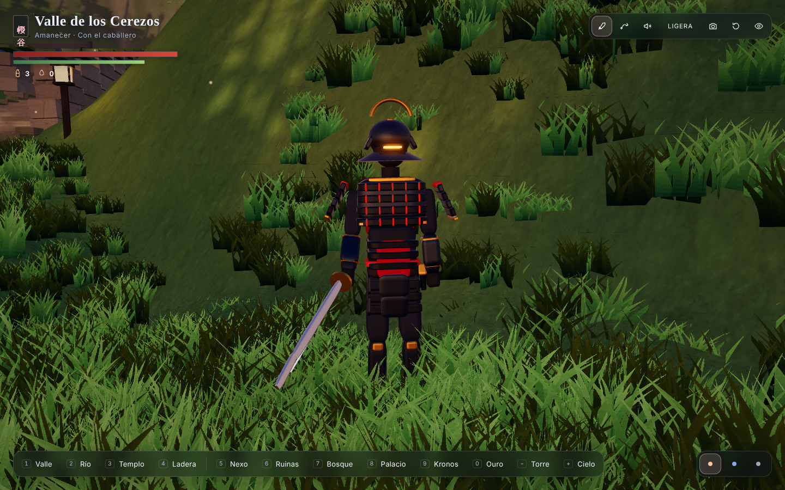 | 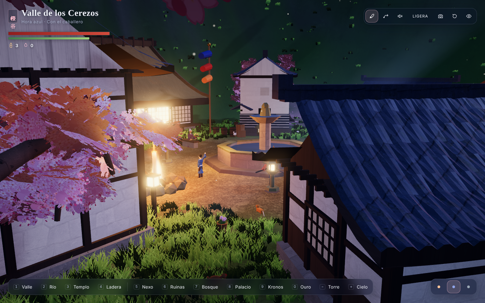 |
| 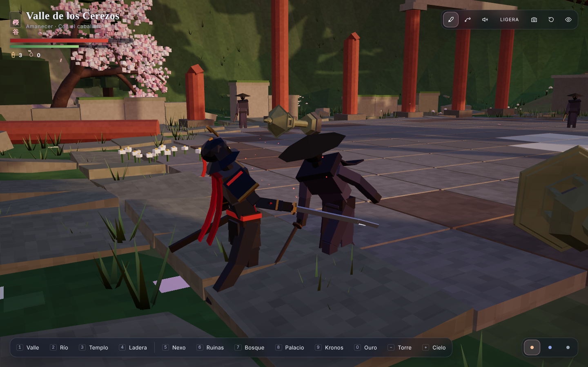 | 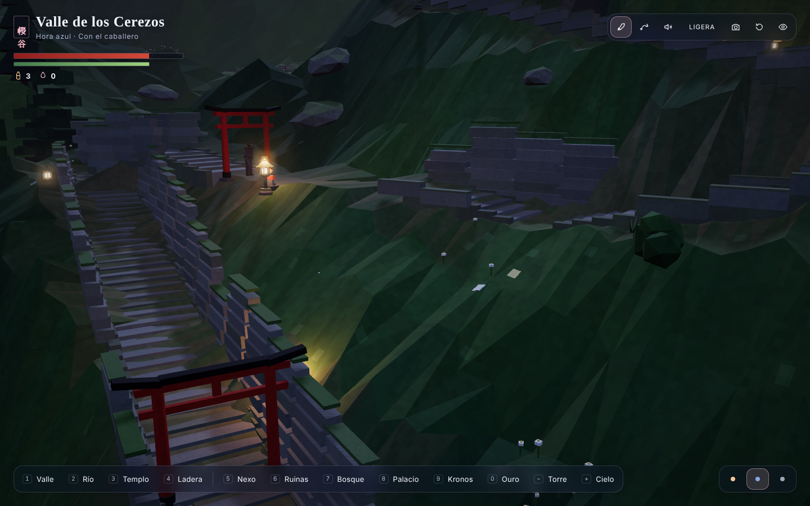 |

## Novedades de esta versión

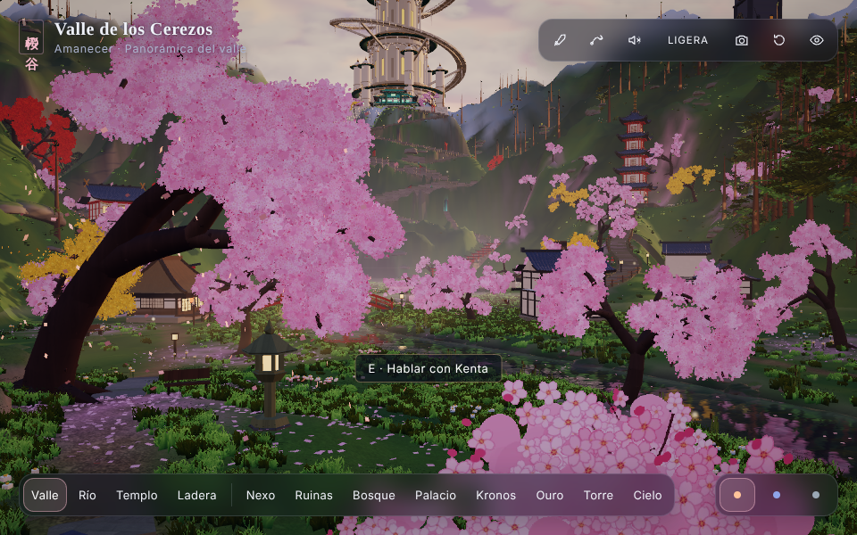

| | |
|---|---|
| 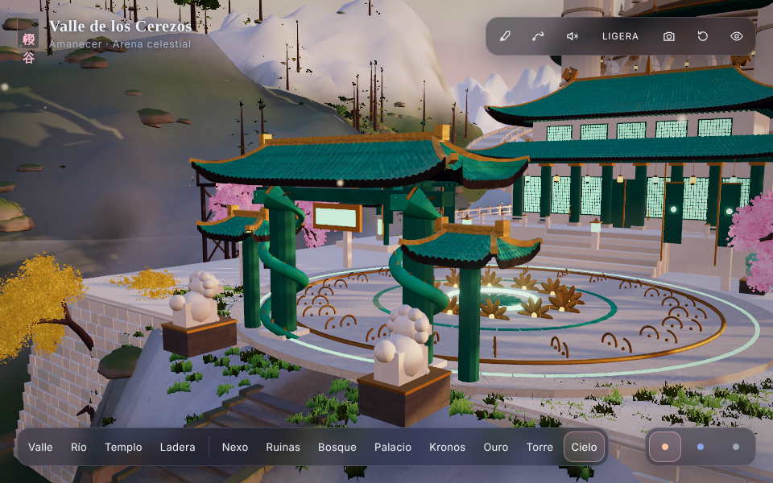 | 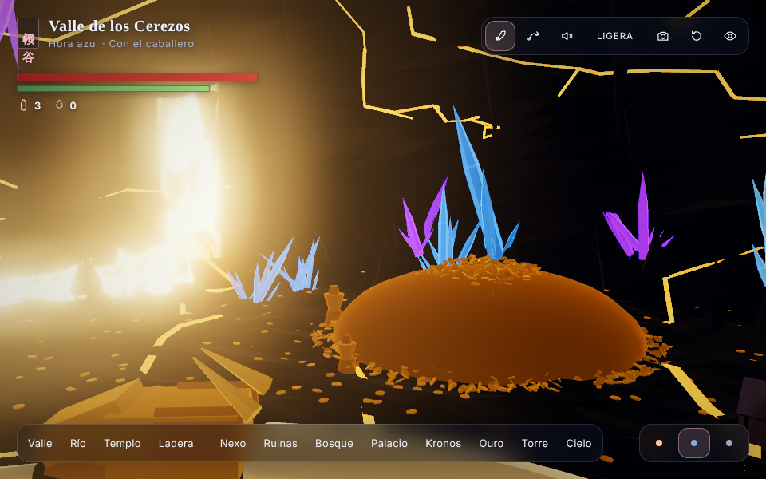 |
| 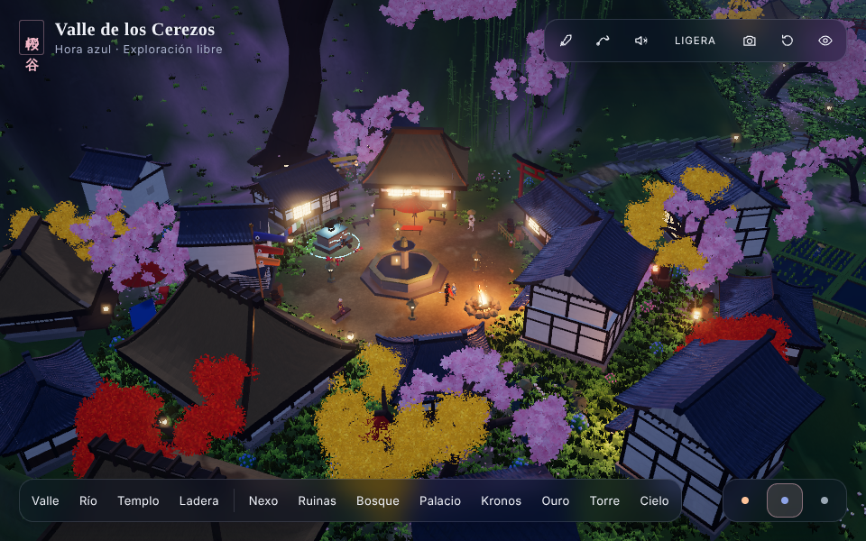 | 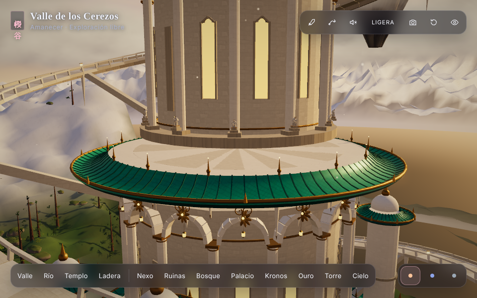 |

- **Personajes humanos con captura de movimiento.** El caballero, los rōnin y los aldeanos usan un humano con esqueleto Mixamo (Xbot de los ejemplos de three.js) y sus animaciones reales (reposo, andar, correr, asentir). La armadura y la ropa se trasladan a sus huesos; los ataques, rodadas, saltos y oficios reorientan los huesos a partir de las poses procedurales.
- **Árboles nuevos.** Copas de cerezo esponjosas (racimos que siempre miran a la cámara), un gran cerezo monumental al oeste de la aldea, arces japoneses rojos, ginkgos dorados y sauces llorones junto al río; las hojas caen revoloteando.
- **Fauna y flora de Polyspoon.** Zorros y conejos con esqueleto y animaciones propias, hortensias azules y rosas, y setas en el bosque (diseños editables en `exports/`).
- **Bóveda de Ouro.** Río y cascadas de lava animada (quema al pisarla), cúmulos de cuarzo azul y morado que brillan, y un portal luminoso en la verja de las ruinas: basta cruzarlo para entrar.
- **Aldea ampliada.** Segundo anillo de nueve casas, puestos de mercado con toldos, farolillos y cuatro vecinos más.
- **Arenas barrocas.** Torre Celestial con rosetones, volutas, faroles colgantes, guerreros dorados y agujas; arena celestial con faroles y estandartes; palacio de jade con columnas de dragón, leones guardianes, mandala dorado y mármol y jade con vetas; arena en ruinas con círculos grabados, columnas caídas, una cabeza colosal, raíces y braseros.
- **Cielo.** Capa alta de nubes con relieve iluminado por el sol y sus sombras cruzando el valle.

## Aspecto visual

- **Terreno suave** (sin facetas) que mezcla seis texturas reales según la pendiente, los caminos, el bosque, la orilla y la nieve, con proyección triplanar en las paredes de roca.
- **Árboles con tarjetas de follaje**: abetos con corteza y verticilos de ramas, árboles de hoja con racimos de hojas reales, helechos y arbustos; los cerezos llevan racimos de flores dibujados.
- **Manto de hierba** denso y con viento alrededor del jugador, además de las matas dispersas por el valle.
- **Arquitectura y rocas con material**: madera, yeso, piedra, tejas, paja y corteza aplicadas sin coordenadas de textura (triplanar), según el color de cada pieza.
- **Personajes redondeados** con armadura laminada y metal que refleja el cielo.
- **Atmósfera**: haces de luz hacia el sol, motas de polen y luz que flotan en el aire, gradación de color y viñeta.

## Zonas

- **Valle central:** río, puente rojo, aldea, casa de té, santuario y pagoda.
- **Aldea inicial y Nexo:** fuente, hoguera principal (punto de aparición) y yunque-altar.
- **Templo en ruinas:** plaza con árbol gigante; verja hacia la bóveda de Ouro.
- **Bosque de antorchas:** camino con luciérnagas y claro para un jefe.
- **Torre del Reloj Quebrada (Kronos):** torre gótica con engranajes sobre un acantilado.
- **Bóveda del Uróboros (Ouro):** caverna de obsidiana con vetas de oro.
- **Palacio de jade y Torre Celestial:** escalinata en zigzag con torii hasta el palacio, y rampa en espiral hasta la arena celestial y la puerta al cielo, el punto más alto del mapa.
- **Arrozales y puesto de té:** entre la aldea y el río, con campesinos, espantapájaros, secadero de arroz y piedras de paso hacia el prado de los ciervos.

Los caminos se tallan en el terreno con pendiente limitada (≈ 20 %): en las laderas aparecen escalones, muros de contención, pretiles, faroles, jizō y torii.

Las coordenadas, conexiones y la API para la fase de juego están en [docs/MAPA.md](docs/MAPA.md).

## Cómo ejecutarlo

Necesita servirse por HTTP (las texturas de `assets/` no se pueden leer abriendo el archivo directamente; si fallan, el mundo se dibuja con el aspecto básico). Funciona en GitHub Pages o en local. Hace falta un navegador con WebGL 2 y conexión, porque Three.js 0.165.0 se carga desde cdn.jsdelivr.net.

Para servirlo en local:

```bash
npm start   # http://localhost:5173
```

## Cómo se juega

La página arranca con el caballero junto a la hoguera del Nexo. Pulsa **V** (o el botón de la espada) para alternar entre jugar y la cámara libre; los botones de vistas también pasan a cámara libre.

| Acción | Teclado y ratón | Táctil |
|---|---|---|
| Moverse | WASD o flechas | Joystick |
| Correr / rodar | Mantener Mayús / tocar Mayús o Q | 走 / 転 |
| Saltar | Espacio | 跳 |
| Atacar / ataque fuerte | Clic / clic derecho (o J / K) | 攻 / 強 |
| Fijar objetivo | Tab o rueda del ratón (clic) | ◎ |
| Hablar, descansar, usar | E | 話 |
| Beber sake (cura) | R | 酒 |
| Mirar y alejar la cámara | Arrastrar y rueda | Arrastrar |

- **Hogueras:** curan, rellenan el sake, devuelven a los enemigos a su sitio y permiten viajar a cualquier hoguera ya encendida. Hay siete: Nexo, claro del bosque, templo en ruinas, cima de Kronos, puerta del palacio, pie de la Torre Celestial y bóveda de Ouro.
- **Rōnin huecos:** el enemigo básico. Patrullan los caminos del bosque, la subida a Kronos, las ruinas y la escalinata del palacio. Cargan el tajo con los ojos encendidos: golpearlos durante la carga los interrumpe; rodar en el momento justo te hace invulnerable.
- **Pétalos de alma:** se ganan al derrotar rōnin. Si caes, se quedan donde caíste hasta que vuelvas a por ellos.
- **Vida en el valle:** aldeanos con diálogo (abuela, herrero, niños, tendera, pescador, viajeros, campesinos, monje, guardia, ermitaña y peregrina), gatos, gallinas, ciervos y mariposas.

## Cámara libre

| Acción | Control |
|---|---|
| Mirar | Arrastrar con el ratón o un dedo |
| Acercar | Rueda o pellizco |
| Explorar | WASD o flechas, Q/E para bajar y subir, Mayús para correr |
| Vistas | 1–9, 0, − (Torre) y + (Cielo) |
| Restablecer, ocultar interfaz, captura | R, H, P |
| Ver colisionadores | C |

La interfaz permite cambiar la atmósfera (amanecer, hora azul, lluvia), la calidad (alta o ligera), activar un recorrido lento de cámara y el sonido ambiental (también los efectos de combate).

## Capturas automáticas

`tools/shoot.mjs` abre la página en Chromium sin interfaz con Playwright y guarda capturas en `shots/`. Sirve Three.js desde `node_modules`, de modo que funciona sin acceso al CDN.

```bash
npm install
npx playwright install chromium
node tools/shoot.mjs prueba 1280 720 '[["wait",20000],["shot","inicio"],["eval","window.__valle.goView(11,true)"],["wait",15000],["shot","cielo"]]'
```

## Estructura

```
index.html          La escena completa (HTML, CSS y JavaScript)
docs/MAPA.md        Zonas, coordenadas, conectividad y API
docs/capturas/      Capturas reales del renderizado
assets/tex/         Texturas WebP (≈1,3 MB) y assets/CREDITOS.md
tools/shoot.mjs     Script de capturas con Playwright
tools/build-assets.py  Prepara las texturas a partir de las descargas de Poly Haven
```
