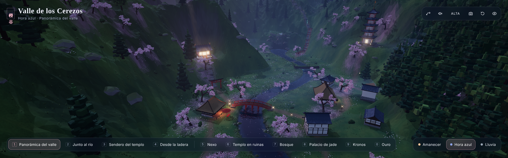

# Valle de los Cerezos

Mundo 3D de un valle japonés de cerezos en flor, renderizado en tiempo real en el navegador con Three.js. Todo el paisaje se genera por código (terreno, río, edificios, vegetación, nubes y luz), sin imágenes ni modelos externos.

Es la base de un juego souls-like: un caballero recorrerá el valle y se enfrentará a jefes en varias arenas.



## Zonas

- **Valle central:** río, puente rojo, aldea, casa de té, santuario y pagoda.
- **Aldea inicial y Nexo:** fuente, hoguera principal (punto de aparición) y yunque-altar.
- **Templo en ruinas:** plaza con árbol gigante; verja hacia la bóveda de Ouro.
- **Bosque de antorchas:** camino con luciérnagas y claro para un jefe.
- **Torre del Reloj Quebrada (Kronos):** torre gótica con engranajes sobre un acantilado.
- **Bóveda del Uróboros (Ouro):** caverna de obsidiana con vetas de oro.
- **Palacio de jade y Torre Celestial:** rampa en espiral hasta la arena celestial y la puerta al cielo, el punto más alto del mapa.

Las coordenadas, conexiones y la API para la fase de juego están en [docs/MAPA.md](docs/MAPA.md).

## Cómo ejecutarlo

No necesita instalación: abre `index.html` en un navegador con WebGL 2 (Chrome, Edge, Firefox o Safari recientes). Three.js 0.165.0 se carga desde cdn.jsdelivr.net, así que hace falta conexión.

Para servirlo en local:

```bash
npm start   # http://localhost:5173
```

## Controles

| Acción | Control |
|---|---|
| Mirar | Arrastrar con el ratón o un dedo |
| Acercar | Rueda o pellizco |
| Explorar | WASD o flechas, Q/E para bajar y subir, Mayús para correr |
| Vistas | 1–9, 0, − (Torre) y + (Cielo) |
| Restablecer, ocultar interfaz, captura | R, H, P |
| Ver colisionadores | C |

La interfaz permite cambiar la atmósfera (amanecer, hora azul, lluvia), la calidad (alta o ligera), activar un recorrido lento de cámara y el sonido ambiental.

## Capturas automáticas

`tools/shoot.mjs` abre la página en Chromium sin interfaz con Playwright y guarda capturas en `shots/`. Sirve Three.js desde `node_modules`, de modo que funciona sin acceso al CDN.

```bash
npm install
npx playwright install chromium
node tools/shoot.mjs prueba 1280 720 '[["wait",20000],["shot","inicio"],["eval","window.__valle.goView(11,true)"],["wait",15000],["shot","cielo"]]'
```

## Estructura

```
index.html          La escena completa (HTML, CSS y JavaScript)
docs/MAPA.md        Zonas, coordenadas, conectividad y API
docs/capturas/      Capturas reales del renderizado
tools/shoot.mjs     Script de capturas con Playwright
```
